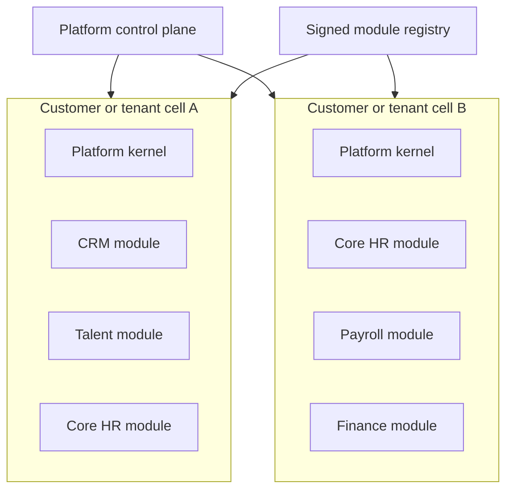
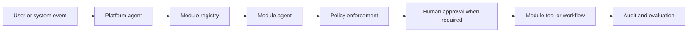

# Platform Foundation

This document describes the target architecture. The current executable reference implementation and its limitations are documented in [Development](../DEVELOPMENT.md) and [Foundation Review](../reports/FOUNDATION_REVIEW.md). Public backbone / private modules is the confirmed distribution model.

## Architectural Decision

The platform uses a small modular backbone plus independently installable domain modules. The backbone is not a traditional all-in-one application: it is the required platform kernel and central control plane. Optional business capabilities are built, versioned, deployed, migrated, and removed as modules.

This design provides:

1. Shared identity, tenancy, policy, workflow, audit, events, configuration, observability, and AI orchestration without duplicating them in every domain.
2. Deployment compositions that include only the modules purchased for a customer or deployment cell.
3. Strong domain ownership and independent module release cycles without allowing core contracts to drift.

## Deployment Model

A dedicated customer deployment or deployment cell is assembled from the core plus its selected module artifacts. Unselected modules contribute no application image, background worker, migration, route, queue consumer, scheduled job, agent tool, or module-specific dependency to that cell.

In a shared SaaS cell, every tenant shares the code deployed to that cell. Physical omission per tenant therefore requires separate cells or grouping tenants by compatible module bundles. Entitlements still control tenant access, but entitlements alone are not treated as module removal.

## Backbone Responsibilities

`gh_replica` owns the non-optional platform kernel:

- Tenant, organization, identity, authentication, authorization, and policy enforcement
- Module registry, dependency resolution, compatibility checks, installation, upgrades, and removal
- Workflow runtime, task state, approvals, schedules, retries, and exception handling
- Event envelope, outbox, idempotency, correlation, and audit contracts
- API gateway, service discovery, secrets references, configuration, and health reporting
- Document, notification, search, and integration interfaces; implementations may be independently deployed
- Agent control plane, model gateway, tool authorization, evaluation, tracing, budgets, and human approvals
- Observability, compliance evidence, data retention controls, and release composition

The backbone does not own module-specific business rules or domain tables.

## Module Repositories

| Repository | Domain ownership | Optional |
| --- | --- | --- |
| `gh-module-client-crm` | Accounts, contacts, opportunities, contracts, and service delivery | Yes |
| `gh-module-recruiting` | Requisitions, jobs, sourcing, applications, interviews, offers, and Hyrlink-derived services | Yes |
| `gh-module-candidate-experience` | Candidate profiles, application reuse, transparency, matching, and Anti-ATS experiences | Yes |
| `gh-module-core-hr` | Worker records, positions, organizations, compensation history, and employment state | Yes |
| `gh-module-lifecycle` | Onboarding, transfers, promotions, offboarding, documents, and provisioning coordination | Yes |
| `gh-module-benefits` | Plans, eligibility, enrollment, dependents, life events, and carrier reconciliation | Yes |
| `gh-module-payroll-time` | Time, leave, earnings, deductions, tax inputs, payroll runs, and reconciliation | Yes |
| `gh-module-accounts-payable` | Vendors, purchase orders, invoices, approvals, and payment preparation | Yes |
| `gh-module-assets-logistics` | Inventory, assets, assignments, shipments, returns, and recovery | Yes |
| `gh-module-financials` | Billing, budgets, allocations, ledger events, close, and forecasting | Yes |
| `gh-module-cases-incidents` | Intake, cases, investigations, evidence, accommodations, and corrective actions | Yes |
| `gh-module-analytics` | Operational metrics, semantic models, process mining, and forecasting | Yes |
| `gh-module-employee-service` | Employee requests, knowledge, communications, notifications, and self-service | Yes |
| `gh-module-integration-packs` | Optional adapters for payroll, benefits, finance, identity, screening, and job boards | Yes |

Workflow automation, the AI agent platform, and administration/security remain core because every installed module depends on them. Their user interfaces can be licensed separately, but their enforcement runtimes cannot be absent.

## Module Contract

Every module must publish a versioned manifest declaring:

- Module identity, semantic version, artifact digests, and minimum compatible core version
- Required and optional module dependencies
- API routes, event subscriptions, event publications, workflow types, scheduled jobs, and permissions
- Database migrations and uninstall behavior
- Agent identity, supported intents, tool definitions, approval classes, and resource limits
- Health checks, telemetry, retention classes, and data ownership
- License and third-party attribution metadata

Installation uses a journaled workflow: validate compatibility, acquire signed artifacts, apply compatible migrations, register capabilities and tools, start workloads, verify health, then activate routes. There is no global transaction across databases, containers, and external providers. Failure rolls back activation where safe, uses explicit compensation or reconciliation where needed, and preserves diagnostic evidence. Removal disables entry points, drains work, applies the declared data-retention policy, unregisters capabilities, and removes module workloads.

## Agent Model

The platform agent is the central coordinator. It identifies the responsible module, creates a traceable work request, and delegates to that module's agent. It does not bypass module APIs or directly change module-owned data.

Each module agent is the domain orchestrator for its module. It may plan work, retrieve approved context, invoke registered module tools, coordinate workflows, and request human approval. It is not the security boundary: every tool invocation is authenticated and authorized by deterministic platform policy, validated against a schema, constrained by tenant and purpose, and written to the audit log.

Agents must fail closed when authorization, tenant context, tool schemas, required evidence, or approval state is missing. High-impact employment, payroll, benefits, financial, and incident decisions always retain deterministic controls and designated human authority.

## Dependency Rules

- Modules depend on versioned core SDKs and contracts, never on another repository's internal code.
- Cross-module operations use APIs, events, or workflow contracts; direct cross-module database access is prohibited.
- Circular module dependencies are prohibited.
- Shared code enters the core only when it is domain-neutral and used by multiple modules.
- A module-specific dependency remains inside that module's artifact and cannot become a backbone dependency accidentally.
- Contract changes require compatibility tests against every supported module version.

## NVIDIA-First Evaluation Policy

The platform should evaluate maintained NVIDIA open-source libraries and deployable services before building equivalent AI infrastructure. NVIDIA use is preferred when it reduces operational toil, meets security and licensing requirements, performs well under representative workloads, and can be isolated behind a platform-owned interface.

Initial candidates include:

- **NeMo Fabric** for integrating and operating agent runtimes through a normalized application interface.
- **NeMo Relay** for agent and tool-call instrumentation, policy middleware, context isolation, guardrails, adaptive behavior, and OpenTelemetry-compatible observability.
- **NeMo Retriever** for document ingestion, extraction, indexing, and retrieval over approved enterprise knowledge.
- **NVIDIA NIM** for self-hosted, versioned inference services when their model and deployment profiles fit the workload.
- **RAPIDS and cuDF** for high-volume analytics, process mining, reconciliation, and feature engineering where GPU acceleration demonstrates a material benefit.
- **TensorRT-LLM or Triton Inference Server** for optimized self-hosted inference when model scale and traffic justify dedicated GPU operations.

Adoption is not automatic. Every candidate must pass license, provenance, security, privacy, portability, cost, benchmark, support-lifecycle, and exit-strategy review. Sensitive HR, payroll, financial, health, and incident data remains within an approved deployment boundary. Platform contracts must prevent an NVIDIA implementation from becoming an undocumented dependency of a business module.

The live NVIDIA skills catalog should be checked when implementation begins in one of these areas. Skills are development guidance, not runtime dependencies, and require explicit approval before installation.

## Planned Repository Creation

All module repositories are private and owned by `Hyrlink-dev`. They use the names in the Module Repositories table and begin from the module template in this repository. Remote creation is complete only after GitHub confirms each repository exists with private visibility; local folders or environment selection entries do not establish that.

## Reference Source Policy

`HyrLink-pro`, `hyrlink`, `HyrLink-MCP`, `hyrlink-pro-mcp`, and `hyrlinkpro-coursework-devtesting` are reference sources. They are not platform module repositories. Reused work must pass license, security, dependency, test, data-contract, and architecture review before being adapted into a new module repository. `AI_resume_chatbot_template` was removed from the selected environment and is not an active reference.
